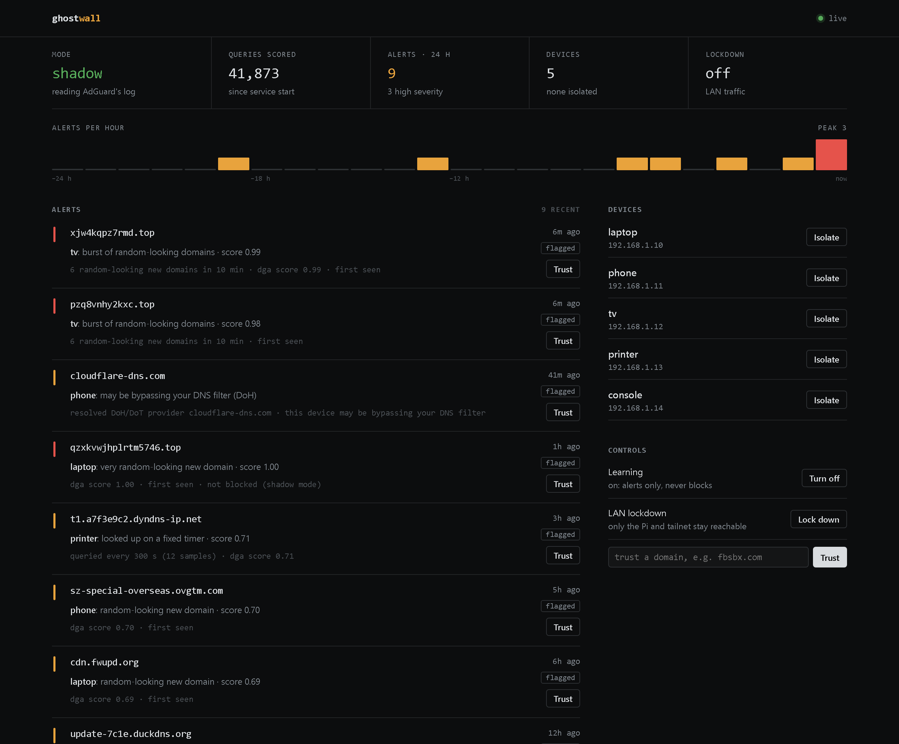

# Ghostwall

[](https://github.com/TRXAlpha/ghostwall/actions/workflows/tests.yml)
[](https://github.com/TRXAlpha/ghostwall/releases)
[](LICENSE)

**A local-first AI DNS firewall for your home network.** Ghostwall runs next to
[AdGuard Home](https://github.com/AdguardTeam/AdGuardHome) or
[Pi-hole](https://pi-hole.net) on a Raspberry Pi, a VM or any small Linux box. It
scores every DNS lookup on your network with tiny CPU models and behavioural
detectors, and tells you (dashboard and Telegram) when a device starts acting like it
is infected. Nothing leaves your network.

> **Status: a working detector, an experimental blocker.** The recommended *shadow
> mode* reads your DNS server's query log and alerts; it cannot break DNS. It has run
> on the author's home network (Raspberry Pi 4 + AdGuard Home) since October 2026.
> New in v0.2 beta: Pi-hole, x86_64 VMs, Docker, and a dashboard password. *Inline
> mode* (Ghostwall answers DNS and blocks) is implemented and unit-tested but not
> proven on a real network. See [Limits](#limits).



<sub>Dashboard with demo data (`python agents/web_ui/demo.py`). Light theme follows your OS:
[screenshot](docs/img/dashboard-light.png).</sub>

## Why not just AdGuard Home or Pi-hole?

Keep them. Ghostwall runs on top and covers what a blocklist can't:

| | AdGuard Home / Pi-hole | + Ghostwall |
|---|---|---|
| Known-bad domains (lists) | yes | yes (threat feed) |
| Random-looking domains nobody has listed yet (DGA) | no | yes |
| DNS tunnelling, timer-like beacons | no | yes |
| A device skipping your filter via DNS-over-HTTPS | no | flagged |
| Per-device "this looks infected" alerts | no | dashboard + Telegram |
| Can break your DNS | it is your DNS | no (shadow mode only reads the log) |

## What it catches

| Rule | Meaning | Severity |
|---|---|---|
| `threat_feed` | the name is on a phishing/malware list (~150k domains, refreshed daily) | high |
| `dga_burst` | one device looked up 5+ different random-looking domains within 10 minutes | high |
| `dga_high` / `dga_suspect` | a single very random-looking name that is new to your network | high / warn |
| `dga_corroborated` | a fairly random name on a rarely-legitimate TLD (`.top`, `.xyz`, ...) | warn |
| `doh_bypass` | a device looked up a DNS-over-HTTPS provider, so it may be skipping your filter | warn |
| `dns_tunnel` | many long random subdomains of one domain (data smuggled over DNS) | high |
| `dns_beacon` | a random-looking name queried on a fixed timer | warn |

An alert, as written to `events.jsonl` and sent to Telegram:

```json
{"time":"2026-10-30T15:11:26Z","device":"phone","domain":"cloudflare-dns.com","rule":"doh_bypass",
 "action":"recommend","severity":"warn",
 "reasons":["resolved DoH/DoT provider cloudflare-dns.com","this device may be bypassing your DNS filter"]}
```

Internal names (`*.local`, `*.ts.net`, single labels, `_service` records) are never
scored, and repeat alerts for the same device and domain are collapsed to one per day.

How well: the domain model alone catches about 60% of algorithmically generated (DGA)
domains at a 1% false-positive rate, so Ghostwall leans on the other detectors and on
novelty (only names new to your network alert). Replaying 8.7 days of one real home
network (70,615 queries, 7 devices) produced 13 alerts. Details:
[docs/ARCHITECTURE.md](docs/ARCHITECTURE.md#detection).

## Install

Pick one. All of them start in shadow mode: your DNS keeps working exactly as before.

### 1. On the box that runs your DNS server (Pi, VM, mini PC)

Needs 64-bit Linux with systemd (Raspberry Pi OS, Debian 12+, Ubuntu 22.04+; arm64 or
x86_64), Python 3.10+, and AdGuard Home or Pi-hole on the same machine.

```bash
git clone https://github.com/TRXAlpha/ghostwall.git
cd ghostwall
sudo ./install.sh
```

The installer finds your DNS server by itself (AdGuard native, snap or Docker; Pi-hole
native or Docker), puts Ghostwall in `/opt/ghostwall` with its own Python venv and a
`ghostwall` system user, starts the systemd services, downloads the threat feed, and
prints the dashboard address and its password. Settings live in
`/etc/ghostwall/ghostwall.env`; re-running the installer (that is also how you update)
keeps them.

With AdGuard Home it also lowers AdGuard's query-log buffer from 1,000 queries to 10 and
restarts AdGuard once (a few seconds without DNS). Otherwise AdGuard can hold queries
for hours before Ghostwall sees them. Pi-hole needs no change.

### 2. Docker: Ghostwall and AdGuard Home together

Any Docker host: a VM, a NAS, a mini PC or a Pi.

```bash
git clone https://github.com/TRXAlpha/ghostwall.git
cd ghostwall
docker compose up -d --build
```

1. Finish AdGuard's setup at `http://<host>:3000` (keep the query log on).
2. `docker compose restart adguardhome` once, so it picks up the faster log setting.
3. Point your router's DNS (or one test device) at the host.
4. Dashboard: `http://<host>:8088`, user `ghostwall`, password from
   `docker compose logs ghostwall | grep password`.

Port 53 already taken on Ubuntu? That is `systemd-resolved`; the "resolved" section of
AdGuard's [Docker docs](https://github.com/AdguardTeam/AdGuardHome/wiki/Docker) shows
how to free it. If every alert names the same `172.x.x.x` device, AdGuard isn't seeing
your clients' real addresses (lookups from the Docker host itself always look like
that); give the `adguardhome` service `network_mode: host` and remove its `ports:`. Already running AdGuard Home or Pi-hole in Docker? Use only the `ghostwall`
service and mount your folders instead (Pi-hole: its container must mount
`/var/log/pihole` from the host too, e.g. `./pihole/log:/var/log/pihole`):

```yaml
  ghostwall:
    build: .
    restart: unless-stopped
    ports: ["8088:8088"]
    environment:
      GHOSTWALL_QUERYLOG: /pihole/log/pihole.log     # AdGuard: /adguard/work/data/querylog.json
    volumes:
      - ./pihole/log:/pihole/log:ro                  # your Pi-hole's /var/log/pihole folder
      - ./ghostwall-data:/data
```

### 3. Just look at it

The dashboard with sample data (stdlib Python only, nothing installed):

```bash
python agents/web_ui/demo.py      # then open http://127.0.0.1:8088
```

### No DNS server yet?

Install [AdGuard Home](https://github.com/AdguardTeam/AdGuardHome#getting-started) or
[Pi-hole](https://docs.pi-hole.net/main/basic-install/) first, or use the Docker option,
which includes AdGuard. A Raspberry Pi 4 or a VM with 1 CPU and 1 GB of RAM is plenty:
Ghostwall itself uses about 100 MB.

## After installing

```bash
tail -f /opt/ghostwall/agents/ghost_dns/events.jsonl   # alerts as they happen
curl -s http://127.0.0.1:5380/status                    # "stats.queries" should keep rising
```

- **Dashboard:** `http://<box>:8088`, user `ghostwall`, password in
  `/etc/ghostwall/ghostwall.env`. To keep it to your tailnet or to the box itself, see
  [Dashboard access](docs/OPERATIONS.md#dashboard-access).
- **Name your devices:** copy `agents/netconf/devices.example.json` to
  `/opt/ghostwall/agents/netconf/devices.json` and fill in your devices so alerts say
  `laptop` instead of an IP.
- **Telegram alerts and `/fw` commands:** [docs/OPERATIONS.md](docs/OPERATIONS.md#telegram).
- **Check it against your own history** (changes nothing):
  `sudo /opt/ghostwall/.venv/bin/python /opt/ghostwall/agents/ghost_dns/replay_querylog.py --querylog <querylog.json or pihole.log>`
- **Update:** `git pull && sudo ./install.sh`. **Remove:** `sudo /opt/ghostwall/uninstall.sh`.

Everything else (going inline, enforcement, the Pi-as-gateway setup, troubleshooting,
rollback): [docs/OPERATIONS.md](docs/OPERATIONS.md).

## How it works

```
devices ──DNS──▶ AdGuard Home or Pi-hole ──▶ internet
                     │ querylog.json / pihole.log
                     ▼
               ghost-dns (shadow) ── scores + detectors ──▶ events.jsonl ──▶ dashboard, Telegram
                     │
               control API 127.0.0.1:5380  (status, allow, isolate, lockdown, learning)
```

`ghost-dns` is the decision core. It scores the registrable part of each name with an
ensemble of a ~108k-parameter recursive model (ONNX) and a hashed character n-gram
logistic regression (pure numpy), then runs the behavioural detectors. In inline mode
the same core answers DNS itself, with AdGuard as its upstream, and can sinkhole.
Full design: [docs/ARCHITECTURE.md](docs/ARCHITECTURE.md). API, event format and
config keys: [docs/REFERENCE.md](docs/REFERENCE.md).

Without the TRM model (no `onnxruntime` build for your platform, e.g. 32-bit ARM),
scoring falls back to the numpy model alone.

## Limits

- **Detection is name-based.** It sees what a device looks up, not what it does
  afterwards. The domain model still misses about 4 in 10 DGA domains.
- **Tested on one home network** (Pi 4, AdGuard Home in Docker). The x86_64 install,
  Pi-hole support and the Docker image are new in v0.2 beta and verified on Ubuntu
  24.04 (x86_64), a Pi 4 and in CI, not yet on many real setups. Expect to allowlist a
  few domains in the first week, and please open an issue with what you see.
- **Inline mode and enforcement are unproven on a real network.** The first inline
  deployment broke a workstation's DNS; the resolver was hardened afterwards (TCP,
  IPv6, upstream fallback, fail-open), but run shadow mode for at least a week first.
  Inline mode needs AdGuard Home.
- **`ghost-flow`** (raw-IP, beacon and JA4 connection checks) and **`capture`**
  (pcap freeze on alert) need the box to be the network's gateway. They are tested on
  recorded traffic only.
- **The dashboard is plain HTTP with a password.** Fine on a home LAN or a tailnet;
  never expose it to the internet. The control API has no authentication and only
  listens on loopback.

## Tests

Stdlib `unittest`, no network needed (`numpy` and `onnxruntime` for the scoring tests).
[CI](https://github.com/TRXAlpha/ghostwall/actions/workflows/tests.yml) runs them on every
push on x86_64 and arm64 with Python 3.10 and 3.13, and builds and smoke-tests the Docker
image on both. To run them yourself:

```bash
for d in agents/ghost_dns/tests agents/ghost_flow/tests agents/fw_bot/tests agents/capture/tests agents/web_ui/tests; do
  python -m unittest discover -s "$d" || break
done
python agents/netconf/test_gen.py
```

## Repository layout

```
install.sh, uninstall.sh   systemd install (shadow mode) and removal
Dockerfile, compose.yaml   container image; Ghostwall + AdGuard Home in one compose file
agents/ghost_dns/   the decision core: resolver, scoring, detectors, shadow follower, control API
agents/web_ui/      dashboard
agents/fw_bot/      Telegram alerts and /fw commands
agents/ghost_flow/  connection inspector (gateway mode)
agents/capture/     per-device pcap ring + freeze on alert (gateway mode)
agents/netconf/     generator for the Pi-as-gateway configs (dnsmasq, nftables, sysctl)
agents/dga_eval/    model evaluation scripts and results
ghostwall/          shipped models + the numpy LR trainer
trm/                model training code
research/           earlier experiments, not used by the firewall
```

## Contributing

Bug reports with your setup (DNS server, how it is installed, OS, CPU) are the most
useful thing right now. A false positive? Include the domain and the alert line. Pull
requests welcome; please run the tests first.

## License

[MIT](LICENSE) © Morogan Christian.
