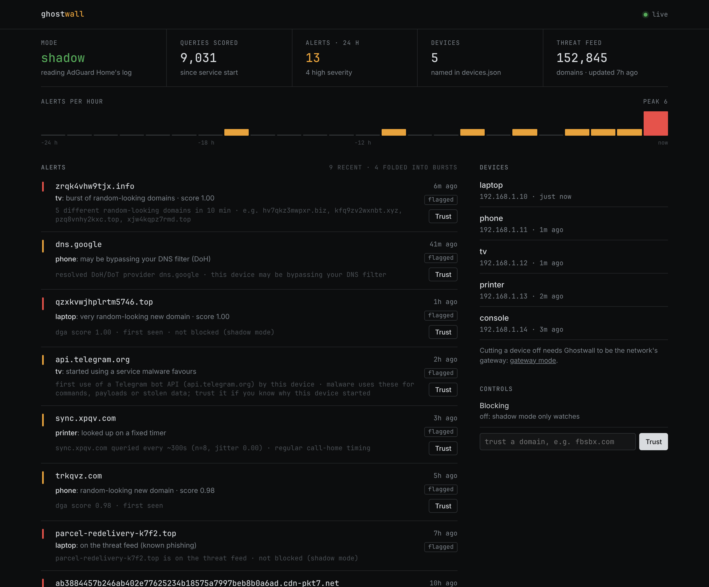

# Ghostwall

[](https://github.com/TRXAlpha/ghostwall/actions/workflows/tests.yml)
[](https://github.com/TRXAlpha/ghostwall/releases)
[](LICENSE)

**Watches each device on your home network for the DNS habits of malware.** Ghostwall runs
next to [AdGuard Home](https://github.com/AdguardTeam/AdGuardHome) or
[Pi-hole](https://pi-hole.net) on a Raspberry Pi, a VM or any small Linux box. It reads
your DNS server's query log and flags a device that suddenly starts using a bot API, a
paste site or a tunnel service, smuggles data through DNS, calls home on a timer, looks up
known malware or phishing domains, bursts through random-looking names, or fails to
resolve one made-up domain after another (malware hunting for its server). It also tells you when a
device skips your DNS filter (DNS-over-HTTPS): not a sign of infection by itself (phones
and browsers do it when "Private DNS" or "secure DNS" is on), but your filter no longer
sees that device. Two small on-device models score how random a name looks; the behaviour
rules do most of the work. Alerts go to a dashboard or Telegram. Ghostwall never sends
your DNS traffic anywhere (one exception: in inline mode, while your DNS server is down,
it answers through a fallback resolver, Quad9 by default; `"upstream_fallbacks": []` turns
that off). The only things it downloads are the daily threat lists and a list of popular sites (Tranco,
so popular sites are never flagged as a whole), and the only thing it
sends out is the alerts themselves, if you turn on Telegram (domain names can be left out
of those too).

> **Status: a detector, with blocking as an experiment.** The recommended *shadow mode*
> only reads the query log and alerts, so it is never in the path of your DNS (installing
> restarts AdGuard once, a few seconds, to make it write its log promptly). It has run on
> the author's home network (Raspberry Pi 4 + AdGuard Home) since late October 2026, which
> is not long, and **it has not caught a real infection yet**: there was none to catch, so
> the numbers from the field are false-alarm counts. Detection rates come from public data
> ([How well it works](#how-well-it-works)). *Inline mode* (Ghostwall answers DNS and
> blocks) passes an end-to-end test in CI (a systemd container with a stand-in AdGuard:
> forwarding, sinkholing, SERVFAIL when the upstream dies, and the way back to shadow
> mode), but is not proven on a real network. See [Limits](#limits).
>
> **Current release: v0.3.0-beta.2** (`nx_burst` catches malware hunting for its server by
> its failed lookups, malware and C2 lists beside the phishing list, and a popular-site guard
> that cuts random-name false positives by about 70% on public data): [CHANGELOG](CHANGELOG.md). Already installed? `git pull && sudo
> ./install.sh` upgrades and keeps your settings, alerts, trusted domains and names.

**Try it** on the box that runs AdGuard Home or Pi-hole:

```bash
git clone https://github.com/TRXAlpha/ghostwall.git && cd ghostwall && sudo ./install.sh
```

It starts in shadow mode (it only reads the query log, so it can't break DNS);
`sudo /opt/ghostwall/uninstall.sh` removes it. Docker and other ways: [Install](#install).



<sub>Demo mode (`python agents/web_ui/demo.py`). Every alert in it came out of the real
detector, run over a scripted day on five made-up devices
([make_demo.py](agents/web_ui/make_demo.py)); a test fails if the two ever disagree.
Light theme follows your OS: [screenshot](docs/img/dashboard-light.png).</sub>

## Why not just AdGuard Home or Pi-hole?

Keep them. Ghostwall runs on top and covers what a blocklist can't:

| | AdGuard Home / Pi-hole | + Ghostwall |
|---|---|---|
| Known phishing, malware and C2 domains | blocks them (with those lists) | also tells you which device tried, and which list named it |
| A camera or TV that starts using Telegram's bot API, a paste site, ngrok, a file drop | no | flagged the first time (each device learns its normal services first) |
| DNS tunnelling, timer-like beacons | no | yes |
| A device using its own DNS-over-HTTPS | no | flagged if it looks the server up by name; by IP too in gateway mode |
| Random-looking domains nobody has listed yet (DGA) | no | about 6 in 10 on [public data](agents/dga_eval/results_public.md), plus bursts of them |
| Malware cycling through generated domains, even word-like ones | no | a burst of failed (NXDOMAIN) lookups: all 25 public DGA families within 10 lookups [in a simulation](agents/dga_eval/results_nx_sim.md) |
| Per-device "this looks infected" alerts | no | dashboard + Telegram |
| Can break your DNS | it is your DNS | no (shadow mode only reads the log) |

## What it catches

| Rule | Meaning | Severity |
|---|---|---|
| `threat_feed` | the name is on a known-bad list: [URLhaus](https://urlhaus.abuse.ch) (malware), [Phishing Army](https://phishing.army) (phishing) and [HaGeZi TIF mini](https://github.com/hagezi/dns-blocklists) (malware, C2, phishing), about 270k domains (3.3 MiB in memory), refreshed daily; the alert says which list. A popular site is never listed as a whole: an entry that is a Tranco top-100k domain or a shared platform (`github.io`, `drive.google.com`) is dropped at download time, while hosts under them (`evil.github.io`) stay ([results_feeds.md](agents/dga_eval/results_feeds.md)). Phishing Army lists some link shorteners and apps as a whole, because phishing runs through them: if one you use alerts, `sudo ghostwall allow <name>` (deliberately no one-tap Trust for these) | high |
| `dga_burst` | one device looked up 5+ different random-looking domains within 10 minutes | high |
| `nx_burst` | one device failed to resolve (NXDOMAIN) 10+ different unregistered domains within 10 minutes: malware searching for its server among generated names, even word-like ones the models miss. Typos, probes under real domains, local and search-domain names, Chrome's random probes and anything your DNS server blocked never count. Needs the answer code: AdGuard's or Pi-hole's log, or inline mode | high |
| `dga_high` / `dga_suspect` | a single very random-looking name that is new to your network (never a popular site's: Tranco top 1M) | high / warn |
| `dga_corroborated` | a fairly random name on a rarely-legitimate TLD (`.top`, `.xyz`, ...) | warn |
| `doh_bypass` | a device looked up a known DNS-over-HTTPS server, so it may be skipping your filter | warn |
| `abused_service` | a device that has been on your network for 3+ days starts using a service malware likes for commands, payloads or stolen data: Telegram's bot API, Discord's CDN, paste sites, ngrok and other tunnels, anonymous file drops, raw GitHub downloads, "what is my IP" lookups | warn |
| `dns_tunnel` | many long random subdomains of one domain (data smuggled over DNS) | high |
| `dns_beacon` | an odd-looking name queried on a fixed timer (never under a popular site: a polled weather or course page is not a call-home) | warn |
| `doh_ip`, `raw_ip`, `beacon` | gateway mode only (`ghost-flow`): a connection straight to a DNS-over-HTTPS server's IP, to an IP nobody looked up, or on a fixed timer | warn / high |

An alert, as written to `events.jsonl` and sent to Telegram:

```json
{"time":"2026-10-30T15:11:26Z","device":"phone","domain":"cloudflare-dns.com","rule":"doh_bypass",
 "action":"recommend","severity":"warn",
 "reasons":["resolved DoH/DoT provider cloudflare-dns.com","this device may be bypassing your DNS filter"]}
```

Internal names (`*.local`, `*.ts.net`, single labels, `_service` records) are never
scored, and repeat alerts for the same device and domain are collapsed to one per day.
A random-looking name that AdGuard Home already blocked raises no alert of its own (no
connection happened, and most of those are ad and tracker junk); it still counts toward a
burst, and the other rules see it as usual.

**How well:** about 6 in 10 random-looking (DGA) names nobody has listed yet are caught
when 1% of normal names are flagged, on public data anyone can check; dictionary-word
DGAs mostly get through, so the behaviour rules above carry most of the weight. The
numbers, how to reproduce them and the LSTM comparison: [How well it works](#how-well-it-works).

## Install

Pick one. All of them start in shadow mode: your DNS keeps working exactly as before.

### 1. On the box that runs your DNS server (Pi, VM, mini PC)

Needs 64-bit Linux with systemd (Raspberry Pi OS, Debian 12 or 13, Ubuntu 22.04 to 26.04;
arm64 or x86_64), Python 3.10+, and AdGuard Home or Pi-hole on the same machine.

```bash
git clone https://github.com/TRXAlpha/ghostwall.git
cd ghostwall
sudo ./install.sh
```

The installer finds your DNS server by itself (AdGuard native, snap or Docker; Pi-hole
native or Docker), puts the code in `/opt/ghostwall` with its own Python venv, starts
the systemd services as an unprivileged `ghostwall` user, downloads the threat lists,
and prints the dashboard address and its password. Settings live in `/etc/ghostwall`,
alerts and state in `/var/lib/ghostwall`; updating and uninstalling both keep them.

With AdGuard Home it also lowers AdGuard's query-log buffer from 1,000 queries to 10 and
restarts AdGuard once (a few seconds without DNS). Otherwise AdGuard can hold queries
for hours before Ghostwall sees them. Pi-hole needs no change.

### 2. Docker: Ghostwall and AdGuard Home together

Any Docker host: a VM, a NAS, a mini PC or a Pi.

```bash
git clone https://github.com/TRXAlpha/ghostwall.git
cd ghostwall
docker compose up -d --build
```

1. Finish AdGuard's setup at `http://<host>:3000` (keep the query log on).
2. Wait for `docker compose logs adguard-tune` to say it set the buffer (about 10 s),
   then `docker compose restart adguardhome` once, so alerts arrive in seconds.
3. Point your router's DNS (or one test device) at the host.
4. Dashboard: `https://<host>:8088` (self-signed: the browser warns once), user `ghostwall`, password from
   `docker compose exec ghostwall ghostwall password`. The same `ghostwall` commands work
   there (`docker compose exec ghostwall ghostwall status`, `... alerts`, `... name`).
5. Telegram (optional): `docker compose exec ghostwall ghostwall telegram`, then
   `docker compose restart ghostwall`; the container runs the bot from then on.

The Ghostwall container runs with no capabilities (if you run AdGuard as a non-root user, it
needs `DAC_OVERRIDE` to read the log, and says so), a
read-only filesystem and `no-new-privileges`, and sees AdGuard's files read-only. Only the
small `adguard-tune` service, which has no network and sees nothing but that folder, can
write AdGuard's config (to lower its log buffer, keeping the file's owner). Images are pinned by digest (Dependabot proposes
bumps weekly). Copy those lines from `compose.yaml` if you write your own service. Docker Hub
rate-limiting your builds? `"registry-mirrors": ["https://mirror.gcr.io"]` in
`/etc/docker/daemon.json` (then restart Docker) pulls the same images from Google's mirror.

Port 53 already taken on Ubuntu? That is `systemd-resolved`; the "resolved" section of
AdGuard's [Docker docs](https://github.com/AdguardTeam/AdGuardHome/wiki/Docker) shows
how to free it. If every alert names the same `172.x.x.x` device, AdGuard isn't seeing
your clients' real addresses (lookups from the Docker host itself always look like
that); give the `adguardhome` service `network_mode: host` and remove its `ports:`.

Already running AdGuard Home or Pi-hole in Docker? Use only the `ghostwall` service and
mount your folders instead (Pi-hole: its container must mount `/var/log/pihole` from the
host too, e.g. `./pihole/log:/var/log/pihole`):

```yaml
  ghostwall:
    build: .
    restart: unless-stopped
    ports: ["8088:8088"]
    environment:
      GHOSTWALL_QUERYLOG: /pihole/log/pihole.log     # AdGuard: /adguard/work/data/querylog.json
    volumes:
      - ./pihole/log:/pihole/log:ro                  # your Pi-hole's /var/log/pihole folder
      - ./ghostwall-data:/data
```

### 3. Just look at it

The dashboard with the demo day (stdlib Python only, nothing installed):

```bash
python agents/web_ui/demo.py      # then open http://127.0.0.1:8088
```

### No DNS server yet?

Install [AdGuard Home](https://github.com/AdguardTeam/AdGuardHome#getting-started) or
[Pi-hole](https://docs.pi-hole.net/main/basic-install/) first, or use the Docker option,
which includes AdGuard. A Raspberry Pi 4 or a VM with 1 CPU and 1 GB of RAM is plenty:
Ghostwall uses about 150 MB (100 MB for the detector, most of it the ONNX runtime, and
about 25 MB each for the dashboard and the Telegram bot).

## After installing

```bash
ghostwall status                  # is it scoring? ("queries" should keep rising)
sudo ghostwall alerts             # what it found, newest first
sudo ghostwall telegram           # alerts on your phone: paste a bot token, message the bot, done
sudo ghostwall allow example.com  # stop alerts for a domain you trust (ghostwall untrust undoes it)
sudo ghostwall calibrate          # after a few days: what each threshold would flag on YOUR network
```

- **Dashboard:** `https://<box>:8088` (plain `http://` redirects there), user `ghostwall`, password from
  `sudo ghostwall password`. To keep it to your tailnet or to the box itself, see
  [Dashboard access](docs/OPERATIONS.md#dashboard-access).
- **Name your devices:** `sudo ghostwall devices` lists the addresses it has seen;
  `sudo ghostwall name 192.168.1.20 laptop` names one, so alerts say `laptop` instead of
  an IP. It records the device's MAC, so the name follows it when DHCP hands out a new
  address, IPv6 privacy addresses included. (Or edit `/etc/ghostwall/devices.json`, as in `agents/netconf/devices.example.json`.)
- **Telegram alerts and `/fw` commands:** `sudo ghostwall telegram`, or by hand:
  [docs/OPERATIONS.md](docs/OPERATIONS.md#telegram).
- **Check it against your own history** (changes nothing):
  `sudo /opt/ghostwall/.venv/bin/python /opt/ghostwall/agents/ghost_dns/replay_querylog.py --querylog <querylog.json or pihole.log>`
  (with your settings; add `--set nx_burst_min_distinct=15`, or any other key, to try a value first)
- **Update:** `git pull && sudo ./install.sh`. **Remove:** `sudo /opt/ghostwall/uninstall.sh`
  (keeps your settings and alerts; `--purge` removes them too).

Everything else (going inline, enforcement, the Pi-as-gateway setup, troubleshooting,
rollback): [docs/OPERATIONS.md](docs/OPERATIONS.md).

## How well it works

**How well, on data anyone can check.** [results_public.md](agents/dga_eval/results_public.md)
uses only public data (25 DGA families from Netlab 360, the Tranco top 1M) and reproduces
with `agents/dga_eval/public_bench.py`. There the shipped models catch 60.3% of DGA
names when 1% of normal names are flagged (53.4% up to v0.2.0-beta.2, which did not
look inside dynamic-DNS names such as `x7kq2v9w.ddns.net`). Dictionary-word DGAs
(`brothernerveplace.com`) get through almost always: they look like normal names. A
plain score therefore only alerts for names new to your network, and the behaviour
rules above do the rest. Is that better than "this name looks random"? On the same names,
character entropy catches 11.6% and the best simple rule tried 16.2% at the same 1% of
normal names flagged
([results_baselines.md](agents/dga_eval/results_baselines.md), `agents/dga_eval/baselines.py`).

A 1-5-gram model retrained on the public data catches 80.5% of names from known families
and 64.8% from families it never saw, against 81.4% and 60.8% for an Endgame-style LSTM.
In a [fairer rematch](agents/dga_eval/results_lstm_fair.md) (the LSTM early-stopped on
held-out names, three seeds each, the same five unseen-family folds) it is 64.6% against
60.9% at 1% false positives and about even at 0.1% (38.0% against 37.2%): the LSTM wins
two folds, the n-gram model wins clearly on folds with dictionary-word families. One
dataset still. The n-gram model scores a name in about 40 µs in plain numpy (x86, one thread). A version trained on all of that data
ships as an opt-in: `"models": "v3-public"` in `/etc/ghostwall/ghost_dns.json`, then
`sudo systemctl restart ghostwall-dns`. It runs without onnxruntime (ghost-dns used 44 MB
instead of 71 MB on the x86 test machine) and its thresholds flag the same share of
normal names as the defaults ([results_v3_public.md](agents/dga_eval/results_v3_public.md)).
It is not the default because it has not been measured on a real network yet. Either way,
`sudo ghostwall calibrate` shows what the thresholds would flag on your own network.

**On private data.** On DRIFT (a 2017-2025 dataset that is not in this repo), trained
on 2017-2019 and tested on 2024-2025, the shipped models catch about 61% of DGA names
at 1% false positives and 47% at 0.2%
([results_shipped.md](agents/dga_eval/results_shipped.md); reproducing it needs the
dataset).

**False positives on lists the thresholds were not set on.**
[results_fp_independent.md](agents/dga_eval/results_fp_independent.md)
(`agents/dga_eval/fp_independent.py`) scores Cisco Umbrella's top 1M DNS names as the
resolver does, treating every name as new: 0.315% would raise a DGA alert (Majestic
0.300%, a Tranco sample 0.503%), so the thresholds stay as shipped. Skipping names whose
registrable domain is a Tranco top-1M site brings that to **0.098%** (745 of 761,951 names,
488 registrable domains) without hiding a single name from the 25 DGA families. The guard
holds 8 MiB. The threat feed reads only the top 100k of the same list, so a malware domain
that ranks lower stays listed. On a real network fewer names are new, so fewer alert.

**Failed lookups (`nx_burst`).** [results_nx_sim.md](agents/dga_eval/results_nx_sim.md)
(`agents/dga_eval/nx_sim.py`) feeds each public DGA family's names through the real
resolver, one every 2 to 60 seconds, assuming they all fail (NXDOMAIN). `nx_burst` fired
for all 25 families on the 10th lookup, including the four word-based ones the models
almost never flag (suppobox, matsnu, gozi, nymaim). When 5% of the names resolve and the
implant stops at the first one that does, it fires first in about 59% of runs. A
simulation: there is no home traffic in this repo to measure its false positives, so
each guard against them has a unit test instead.

Replaying 12.9 days of the author's network (115,549 queries, before the
dynamic-DNS fix and the behaviour rules added since) gave 17 alerts: 4 test lookups the
author made, 3 devices using DNS-over-HTTPS, 9 random-looking ad-redirect and pop-up
style domains on the author's computers and phone, and 1 false positive (a weather
script polling every 15 minutes). That is one network: please
[open an issue](https://github.com/TRXAlpha/ghostwall/issues) with what you see on yours.
Details: [docs/ARCHITECTURE.md](docs/ARCHITECTURE.md#detection).

## How it works

```
devices ──DNS──▶ AdGuard Home or Pi-hole ──▶ internet
                     │ querylog.json / pihole.log
                     ▼
               ghost-dns (shadow) ── scores + detectors ──▶ events.jsonl ──▶ dashboard, Telegram
                     │
               control API 127.0.0.1:5380  (status, allow, isolate, lockdown, learning)
```

`ghost-dns` is the decision core. It scores the registrable part of each name with two
models and averages them: a ~108k-parameter recursive neural net (ONNX) and a hashed
character n-gram logistic regression (pure numpy). The neural net is the better of the
two at low false-positive rates (62% vs 55% caught at 1%; 58% vs 51% on names unseen
in training); the average ranks best overall. Then it runs the behavioural detectors. In inline mode the same core answers
DNS itself, with AdGuard as its upstream, and can sinkhole.
Full design: [docs/ARCHITECTURE.md](docs/ARCHITECTURE.md). API, event format and
config keys: [docs/REFERENCE.md](docs/REFERENCE.md).

Without onnxruntime (no build for your platform, e.g. 32-bit ARM), scoring falls back
to the n-gram model alone, which catches about 5 points fewer DGA names at the same
false-positive rate; `"models": "v3-public"` is made for that case. (Up to
v0.2.0-beta.2 such installs wrote no score-based alerts at all: building the alert failed
on the missing model's empty score.)

## Limits

- **Baselines trust what is already there.** `abused_service` learns each device's usual
  services in its first 3 days, and novelty counts names as normal after a week. A device
  that is already infected when you install Ghostwall teaches it that its malware is
  normal; the threat lists, bursts, tunnels and DoH rules don't depend on a baseline.
- **Detection is name-based.** It sees what a device looks up, not what it does
  afterwards. The models miss about 4 in 10 DGA domains, and nearly all made of
  dictionary words; `nx_burst` catches those by their failed lookups instead, but only
  while most of them fail, and not an implant slower than about one lookup a minute
  (its numbers are a simulation, not field results). Malware that talks to shared
  services (cloud storage, CDNs, chat apps) looks like everyone else, and a device with
  hardcoded DNS-over-HTTPS is invisible in shadow mode unless it looks the server up by name
  (gateway mode catches it by IP: `doh_ip`). Any web
  page can also make your browser look up random-looking names, so an alert means
  "check this device", not proof of infection; alerts are capped per device per
  minute so such a page can't flood you.
- **One DNS client for the whole house hides who did what.** If your router forwards
  every device's DNS to AdGuard or Pi-hole, they all look like the router: per-device
  rules then add up the whole household (ten dead domains from different devices can
  raise one `nx_burst`). Point devices at the box directly (DHCP's DNS server option).
  Tools that check many domains on purpose (link checkers, mail filters, dnstwist) look
  like `nx_burst` too: list that device in `nx_burst_ignore_devices`.
- **Tested on one home network** (Pi 4, AdGuard Home in Docker). The x86_64 install,
  Pi-hole support and the Docker image are new in v0.2 and verified on Ubuntu 24.04
  (x86_64), a Pi 4, the official Pi-hole Docker image and in CI, not yet on many real setups. Expect
  to allowlist a few domains in the first week, and please open an issue with what you see.
- **Inline mode and enforcement are unproven on a real network** (CI tests inline mode
  end to end in a container). The first inline
  deployment broke a workstation's DNS; the resolver was hardened afterwards (TCP,
  IPv6, upstream fallback, fail-open), but run shadow mode for at least a week first.
  Inline mode needs AdGuard Home.
- **Isolating a device and LAN lockdown need gateway mode** (the box routes your LAN's
  traffic). In the default setup the dashboard doesn't offer them and the API refuses.
- **`ghost-flow`** (raw-IP, DoH-by-IP, beacon and JA4 connection checks) and **`capture`**
  (pcap freeze on alert) need gateway mode too. CI runs them in a lab container (a device
  and a "wan" in network namespaces): the generated firewall loads on nftables 1.0.6,
  isolation and lockdown change it, ghost-flow reads a real kernel queue, capture runs
  real tcpdump. Not yet on a real network.
- **The dashboard is HTTPS with a self-signed certificate** (the installer makes it and
  prints its fingerprint; browsers warn once) and a password. Fine on a home LAN or a
  tailnet; never expose it to the internet. The control API
  listens on loopback only, refuses requests from web pages, and takes actions only with
  a token that only the `ghostwall` user can read.
- **Telegram alerts go through Telegram's servers.** They name the device and domain,
  unless you set `FW_BOT_PRIVACY=minimal` in `/etc/ghostwall/fw_bot.env`: then they say
  only which device and what kind of alert, and the rest stays on the dashboard.

## Tests

Stdlib `unittest`, no network needed (`numpy` and `onnxruntime` for the scoring tests).
[CI](https://github.com/TRXAlpha/ghostwall/actions/workflows/tests.yml) runs on every push:

- unit tests on x86_64 and arm64 with Python 3.10, 3.13 and 3.14, and pyflakes;
- `tests/installer_e2e.sh`: `install.sh` for real under systemd on Debian 12 and 13 and
  Ubuntu 22.04, 24.04 and 26.04 (inline mode, update and uninstall included), and an upgrade
  over v0.2.0-beta.2 that must keep its alerts, trusted domains, names and thresholds;
- `tests/gateway_e2e.sh`: ghost-flow on a real kernel queue, capture with real tcpdump, the
  generated nftables ruleset;
- the Docker image on both CPUs, with no capabilities, including Telegram alerts;
- weekly, every pinned Python package against the OSV vulnerability database.

To run the unit tests yourself:

```bash
for d in agents/ghost_dns/tests agents/ghost_flow/tests agents/fw_bot/tests agents/capture/tests agents/web_ui/tests; do
  python -m unittest discover -s "$d" || break
done
python agents/netconf/test_gen.py
```

## Repository layout

```
install.sh, uninstall.sh   systemd install (shadow mode) and removal
Dockerfile, compose.yaml   container image; Ghostwall + AdGuard Home in one compose file
agents/ghost_dns/   the decision core: resolver, scoring, detectors, shadow follower, control API
agents/web_ui/      dashboard, and the demo generated by the real detector
agents/fw_bot/      Telegram alerts and /fw commands
agents/ghost_flow/  connection inspector (gateway mode)
agents/capture/     per-device pcap ring + freeze on alert (gateway mode)
agents/netconf/     generator for the Pi-as-gateway configs (dnsmasq, nftables, sysctl)
agents/dga_eval/    evaluation: shipped models on DRIFT (eval_shipped.py -> results_shipped.md),
                    public benchmark (public_bench.py -> results_public.md), LSTM rematch
                    (fair_lstm.py), simple baselines (baselines.py -> results_baselines.md)
tests/              installer, upgrade and gateway end-to-end tests, OSV audit
ghostwall/          shipped models + the numpy LR trainer
trm/                neural-net training code
```

## Contributing

What changed between versions: [CHANGELOG.md](CHANGELOG.md).

Bug reports with your setup (DNS server, how it is installed, OS, CPU) are the most
useful thing right now. A false positive? Include the domain and the alert line. Pull
requests welcome; please run the tests first.

## License

[MIT](LICENSE) © Morogan Christian.
